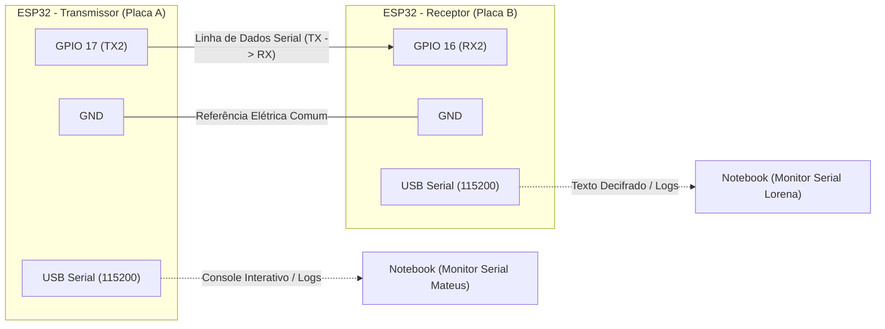
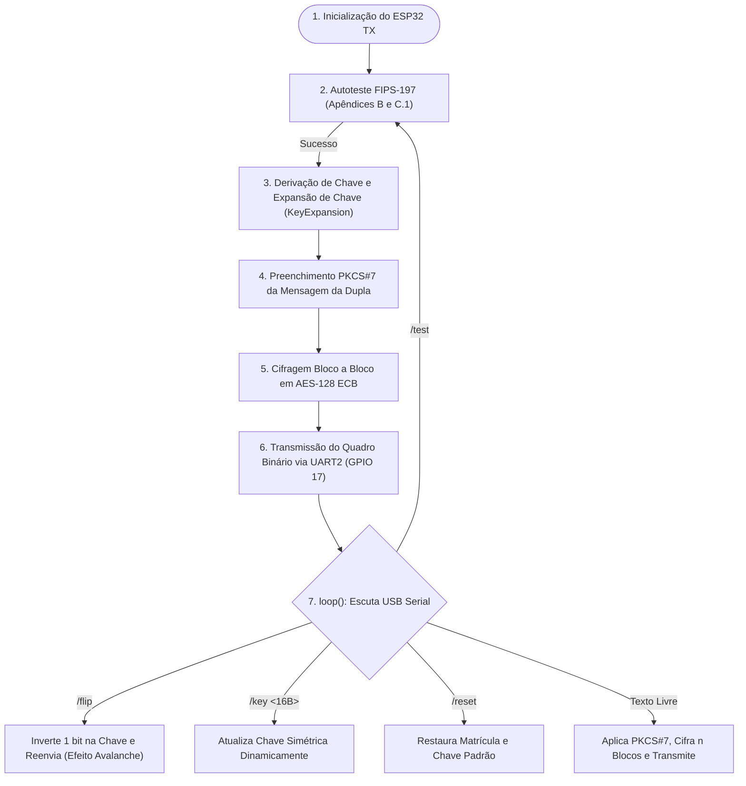
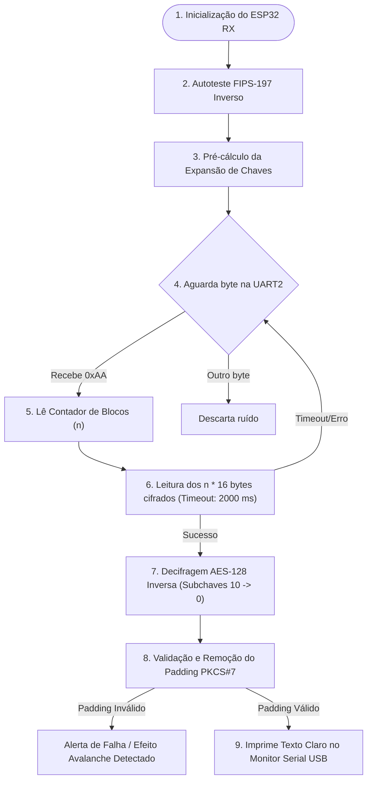

# Segurança de Sistemas de Computação — Criptografia Simétrica (AES-128 no ESP32)

> **Disciplina:** Segurança em Sistemas Computacionais — IFMT  
> **Tema:** Atividade Prática 2 — AES-128 em Dois ESP32 via UART  
> **Dupla de Desenvolvimento:** Mateus & Lorena  
> **Data de Entrega:** 19/10/2026 até às 23h59  

---

## Visão Geral da Atividade

Projeto prático desenvolvido para a disciplina de **Segurança de Sistemas de Computação** do **Instituto Federal de Educação, Ciência e Tecnologia de Mato Grosso (IFMT)**, sob orientação do **Prof. Dr. Ruy de Oliveira**.

O objetivo central é implementar o algoritmo **AES-128 (Advanced Encryption Standard)** puramente em C/C++ **100% do zero**, sem o uso de bibliotecas criptográficas externas (como `mbedtls`, `tinycrypt`, etc.), em dois microcontroladores **ESP32** comunicando-se diretamente por hardware através do barramento serial **UART2**.

---

## 1. Identificação da Dupla e Regras de Negócio

| Integrante | Matrícula | 8 Dígitos Finais | Papel Primário no Projeto | Firmware Principal |
| :--- | :---: | :---: | :--- | :--- |
| **Lorena Strobel** | `2023278440028` | `78440028` | Aluno A (Desenvolvimento do Receptor) | [`receptor/receptor.ino`](file:///home/spacery/Documents/[CodeRoot]/IFMT/Segurança-Sistemas-Computacionais/SSC-Criptografia-Simetrica/receptor/receptor.ino) |
| **Mateus de Souza** | `2023278440030` | `78440030` | Aluno B (Desenvolvimento do Transmissor) | [`transmissor/transmissor.ino`](file:///home/spacery/Documents/[CodeRoot]/IFMT/Segurança-Sistemas-Computacionais/SSC-Criptografia-Simetrica/transmissor/transmissor.ino) |

### Parâmetros Criptográficos Derivados:
* **Chave Simétrica Mestre (128 bits / 16 bytes ASCII)**:  
  Composta pela concatenação dos 8 dígitos finais de Lorena (Aluno A) e Mateus (Aluno B):  
  $$\text{Chave} = \text{"7844002878440030"}$$  
  Em hexadecimal: `0x37 0x38 0x34 0x34 0x30 0x30 0x32 0x38 0x37 0x38 0x34 0x34 0x30 0x30 0x33 0x30`

* **Mensagem em Texto Claro da Dupla (31 bytes ASCII)**:  
  $$\text{Mensagem} = \text{"A:2023278440028;B:2023278440030"}$$

* **Preenchimento PKCS#7 Dinâmico**:  
  Como cada bloco AES opera rigidamente sobre 16 bytes:
  $$\text{Tamanho} = 31 \text{ bytes} \implies 32 - 31 = 1 \text{ byte de padding}$$  
  O byte de preenchimento adicionado ao final é `0x01`, totalizando exatamente 32 bytes (2 blocos de 16 bytes).

---

## 2. Topologia de Hardware e Conexão Física (UART2)

A comunicação entre as placas utiliza o periférico serial por hardware **UART2** do ESP32 operando a **115200 bps, 8N1** (8 bits de dados, sem paridade, 1 stop bit).



### Pinagem Física Obrigatória:
* **GPIO 17 (TXD2)** do Transmissor $\rightarrow$ conectado ao **GPIO 16 (RXD2)** do Receptor.
* **GND** do Transmissor $\rightarrow$ interligado ao **GND** do Receptor (*essencial para equalizar os referenciais elétricos*).

---

## 3. Protocolo de Envio em Bytes Binários Brutos

Diferente de protocolos baseados em texto ASCII ou strings hexadecimais, o envio serial opera em **bytes binários brutos** (`Serial2.write`), otimizando a largura de banda e aderindo estritamente à especificação do trabalho:

| Posição do Byte | Campo | Tipo | Descrição |
| :---: | :---: | :---: | :--- |
| `0` | **Marcador de Sincronismo** | `uint8_t` | Fixo em `0xAA` (alinhamento de quadro e descarte de ruído elétrico). |
| `1` | **Contador de Blocos ($n$)** | `uint8_t` | Quantidade de blocos cifrados subsequentes ($n = 2$ para a mensagem da dupla). |
| `2` a $(n \times 16 + 1)$ | **Carga Útil Cifrada** | `uint8_t[]` | $n \times 16$ bytes binários resultantes da cifragem AES-128 ECB. |

---

## 4. Especificação Técnica do Transmissor (TX — [`transmissor.ino`](file:///home/spacery/Documents/[CodeRoot]/IFMT/Segurança-Sistemas-Computacionais/SSC-Criptografia-Simetrica/transmissor/transmissor.ino))

O Transmissor foi projetado em **modo duplo**: realiza a transmissão automática oficial na inicialização e mantém um **Console Interativo via USB** aberto para comandos durante a arguição prática do professor.



### Passo a Passo dos Cálculos no TX:

1. **Autoteste NIST FIPS-197 (`run_fips197_selftest`)**:
   * Antes de processar os dados da turma, o firmware valida a cifragem contra os vetores oficiais do NIST (Apêndice B e Apêndice C.1).
   * Apenas se ambos retornarem `[PASS]`, o sistema prossegue.

2. **Expansão de Chave (`KeyExpansion`)**:
   * Expande a chave mestra de 16 bytes em **44 palavras de 32 bits** ($w[0]$ a $w[43]$), formando as **11 subchaves de rodada** (176 bytes no total).
   * Para cada palavra múltipla de 4 ($w[4i]$), aplica:
     * `RotWord`: rotação cíclica de 1 byte para a esquerda.
     * `SubWord`: substituição de cada byte pela S-Box do Rijndael.
     * Constante de rodada $Rcon[i/4]$ aplicada via XOR no byte mais significativo.

3. **Preenchimento PKCS#7 Dinâmico (`aplicar_padding_pkcs7`)**:
   * Calcula o preenchimento necessário para que a mensagem atinja o próximo múltiplo de 16 bytes:  
     $$\text{pad} = 16 - (\text{len} \pmod{16})$$
   * Para os 31 bytes das matrículas, preenche com 1 byte `0x01`.

4. **Laço Mestre de Cifragem AES-128 (`aes128_encrypt_block`)**:
   * O texto é organizado na matriz de estado $4 \times 4$ (ordem coluna por coluna / *column-major*).
   * **Rodada Inicial (Round 0)**: `AddRoundKey` com a subchave $0$ ($w[0..3]$).
   * **Rodadas 1 a 9**:
     1. `SubBytes`: Substituição não linear byte a byte utilizando a S-Box estática gravada em memória de programa (`PROGMEM`).
     2. `ShiftRows`: Permutação cíclica das linhas para a esquerda (Linha 0: 0 bytes; Linha 1: 1 byte; Linha 2: 2 bytes; Linha 3: 3 bytes).
     3. `MixColumns`: Transformação linear multiplicando cada coluna no corpo finito de Galois $GF(2^8)$ módulo o polinômio irredutível $P(x) = x^8 + x^4 + x^3 + x + 1$ (`0x11B`).  
        A multiplicação por $\{02\}$ é implementada com a primitiva atômica `xtime()`:
        ```c
        static inline uint8_t xtime(uint8_t b) {
            return (uint8_t)((b & 0x80) ? ((b << 1) ^ 0x1B) : (b << 1));
        }
        ```
        A multiplicação por $\{03\}$ é obtida por $\text{xtime}(b) \oplus b$.
     4. `AddRoundKey`: XOR entre o estado e a subchave da rodada correspondente.
   * **Rodada Final (Round 10)**: Executa `SubBytes`, `ShiftRows` e `AddRoundKey` (a etapa `MixColumns` é omitida na última rodada).

5. **Envio Binário**:
   * Transmite o pacote `[0xAA, 0x02, bloco0 (16B), bloco1 (16B)]` pelo pino GPIO 17.

6. **Comandos do Console Interativo USB**:
   * `/test`: Reexecuta os autotestes do NIST em tempo real sob demanda.
   * `/flip`: Inverte 1 bit na chave mestre e retransmite a mensagem (demonstração imediata do **Efeito Avalanche**).
   * `/key <16_caracteres>`: Permite ao professor testar qualquer chave arbitrária de 128 bits.
   * `/reset`: Restaura a chave e mensagem oficial da dupla.
   * *Qualquer outro texto digitado*: Cifra dinamicamente a quantidade necessária de blocos ($n$) e envia via UART2.

---

## 5. Especificação Técnica do Receptor (RX — [`receptor/receptor.ino`](file:///home/spacery/Documents/[CodeRoot]/IFMT/Segurança-Sistemas-Computacionais/SSC-Criptografia-Simetrica/receptor/receptor.ino))

O Receptor atua como um nó de escuta passivo e resiliente na UART2 (GPIO 16), com proteção por tempo limite (*timeout*) e decifragem inversa em tempo real.



### Passo a Passo dos Cálculos no RX:

1. **Sincronização e Timeout**:
   * A máquina de estados aguarda continuamente o byte marcador `0xAA`.
   * Ao detectar `0xAA`, lê o byte seguinte ($n$). Se $n = 0$ ou $n > 16$, o pacote é rejeitado.
   * Coleta sequencialmente os $n \times 16$ bytes da carga útil com janela de tolerância de até 2000 ms (`TEMPO_LIMITE_MS`). Se a linha oscilar ou o transmissor desconectar, o pacote corrompido é descartado sem travar a placa.

2. **Decifragem AES-128 Inversa (`decifrar_bloco_aes128`)**:
   * Carrega os bytes cifrados na matriz de estado $4 \times 4$.
   * **Rodada Inicial Inversa**: `AddRoundKey` com a Subchave 10.
   * **Rodadas 9 até 1**:
     1. `InvShiftRows`: Deslocamento cíclico das linhas para a **DIREITA** (Linha 1: 1 byte; Linha 2: 2 bytes; Linha 3: 3 bytes).
     2. `InvSubBytes`: Substituição inversa utilizando a tabela `tabela_sbox_inversa`.
     3. `AddRoundKey`: XOR com a subchave da rodada correspondente.
     4. `InvMixColumns`: Multiplicação matricial inversa no corpo $GF(2^8)$ pelos coeficientes polinomiais $\{0e, 0b, 0d, 09\}$. As funções são computadas puramente através de somas (XOR) e do operador `xtime`:
        * Multiplicação por $\{09\} = 2^3 + 1$
        * Multiplicação por $\{0b\} = 2^3 + 2 + 1$
        * Multiplicação por $\{0d\} = 2^3 + 2^2 + 1$
        * Multiplicação por $\{0e\} = 2^3 + 2^2 + 2$
   * **Rodada Final Inversa (Round 0)**: Executa `InvShiftRows`, `InvSubBytes` e `AddRoundKey` com a Subchave 0 (sem `InvMixColumns`).

3. **Validação e Remoção do Preenchimento PKCS#7 (`remover_padding_pkcs7`)**:
   * Inspeciona o último byte do bloco ($k$).
   * Valida se $1 \le k \le 16$ e se **todos** os últimos $k$ bytes contêm exatamente o valor $k$.
   * Se a integridade for confirmada, remove o preenchimento, insere o terminador nulo `\0` e imprime a string original limpa no monitor USB.
   * Se o padding falhar (como ocorre no comando `/flip`), o receptor emite um alerta de erro sem sofrer travamento de memória.

---

## 6. Roteiro de Demonstração para a Apresentação Oral

Este roteiro organiza os passos recomendados durante a arguição prática com o professor:

```text
1. LIGAR AS PLACAS (Monitor Serial a 115200 baud)
   ├─ Visualizar no boot de ambos os ESP32 o autoteste NIST FIPS-197:
   │  └─ [PASS] Apêndice B e [PASS] Apêndice C.1
   └─ O TX deriva a chave "7844002878440030" e envia a mensagem padrão da dupla.

2. CONFERIR O RECEPTOR
   └─ O RX exibe os 32 bytes recebidos em hexadecimal, valida o padding (0x01)
      e imprime: "A:2023278440028;B:2023278440030".

3. DEMONSTRAÇÃO DO EFEITO AVALANCHE (TX -> RX)
   ├─ No Monitor Serial do TX, digitar o comando: /flip
   ├─ O TX inverte 1 bit na chave mestre e retransmite o pacote.
   └─ No RX: O texto decifrado se transforma em lixo indecifrável e o receptor
      reporta erro no padding PKCS#7, comprovando a sensibilidade a nível de bit.

4. DEMONSTRAÇÃO DO CONSOLE INTERATIVO
   ├─ Digitar no TX: /reset (restaura os parâmetros padrão).
   ├─ Digitar frases arbitrárias no TX (ex: "Seguranca IFMT 2026").
   └─ O TX calcula o novo PKCS#7 dinamicamente e o RX decifra perfeitamente.
```

---

## 7. Instruções de Compilação e Gravação (Arduino IDE)

### Pré-requisitos:
* **Arduino IDE 2.x** instalado.
* Pacote de placas **esp32** instalado no *Boards Manager* (versão recomendada: 2.x ou 3.x).
* Permissão de acesso serial no Linux: `sudo usermod -a -G dialout $USER`.

### Gravação do Transmissor (TX):
1. Conecte o ESP32 do Transmissor à porta USB do computador.
2. Abra o arquivo [`transmissor/transmissor.ino`](file:///home/spacery/Documents/[CodeRoot]/IFMT/Segurança-Sistemas-Computacionais/SSC-Criptografia-Simetrica/transmissor/transmissor.ino).
3. Selecione a placa: **ESP32 Dev Module** (ou **DOIT ESP32 DEVKIT V1**).
4. Selecione a porta serial correspondente (ex: `/dev/ttyUSB0`).
5. Clique em **Carregar / Upload** (`Ctrl + U`).
6. Abra o Monitor Serial a **115200 baud** com terminação de linha **Newline (`\n`)**.

### Gravação do Receptor (RX):
1. Conecte o ESP32 do Receptor à porta USB do computador.
2. Abra o arquivo [`receptor/receptor.ino`](file:///home/spacery/Documents/[CodeRoot]/IFMT/Segurança-Sistemas-Computacionais/SSC-Criptografia-Simetrica/receptor/receptor.ino).
3. Selecione a placa: **ESP32 Dev Module** (ou **DOIT ESP32 DEVKIT V1**).
4. Selecione a porta serial correspondente (ex: `/dev/ttyUSB1`).
5. Clique em **Carregar / Upload** (`Ctrl + U`).
6. Abra o Monitor Serial a **115200 baud**.

---

## 8. Estrutura do Repositório

```text
SSC-Criptografia-Simetrica/
├── .gitignore                  # Arquivos e diretórios ignorados pelo Git
├── README.md                   # Documentação técnica integral da atividade
├── transmissor/
│   └── transmissor.ino         # Firmware do Transmissor TX (Mateus - Aluno B)
├── receptor/
│   └── receptor.ino            # Firmware do Receptor RX (Lorena - Aluno A)
├── relatorio/
│   └── README.md               # Estrutura do Relatório Técnico de 4 páginas
└── utils/
    └── Trabalho_AES-128_ESP32.pdf # Enunciado oficial das diretrizes da avaliação
```
