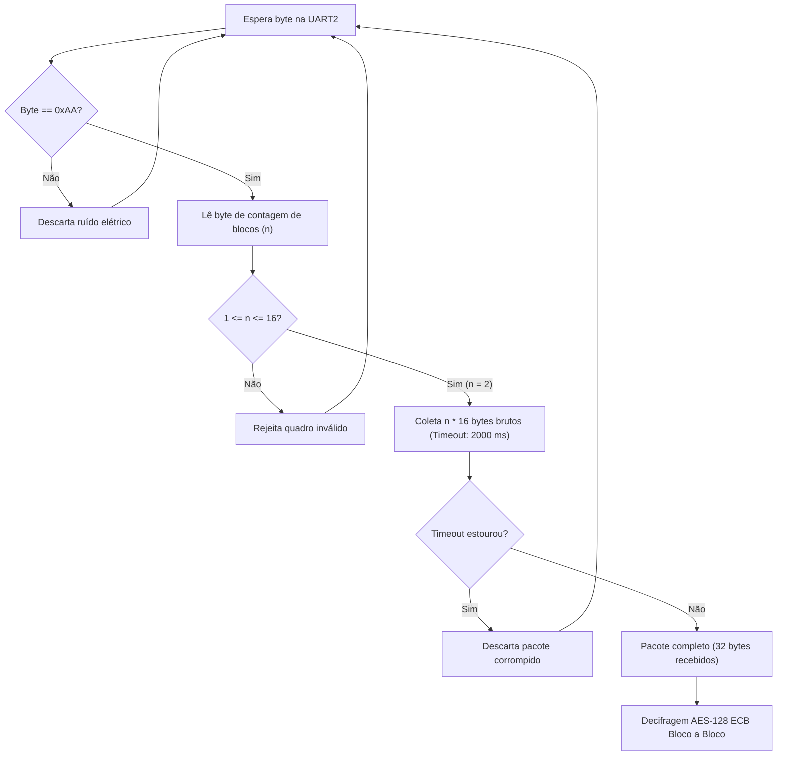

# Especificação dos Cálculos Matemáticos do Receptor (RX — AES-128)

Este documento descreve detalhadamente todos os **cálculos matemáticos, transformações matriciais inversas e rotinas de validação** executados pelo firmware do **Receptor (RX)** ([`receptor/receptor.ino`](file:///home/spacery/Documents/[CodeRoot]/IFMT/Segurança-Sistemas-Computacionais/SSC-Criptografia-Simetrica/receptor/receptor.ino)), implementado por **Lorena Strobel (Aluno A)** em conjunto com **Mateus de Souza (Aluno B)** para a disciplina de Segurança de Sistemas de Computação do IFMT.

Os cálculos a seguir demonstram o processamento inverso ponta a ponta do cenário oficial das **matrículas da dupla** definido no enunciado do projeto ([`utils/Trabalho_AES-128_ESP32.pdf`](file:///home/spacery/Documents/[CodeRoot]/IFMT/Segurança-Sistemas-Computacionais/SSC-Criptografia-Simetrica/utils/Trabalho_AES-128_ESP32.pdf)).

---

## 1. Dados de Entrada do Receptor (Carga Útil e Parâmetros)

### 1.1. Identificação e Chave Simétrica Mestre
O receptor é configurado com a mesma chave simétrica mestre derivada da concatenação dos 8 últimos dígitos das matrículas:

* **Lorena (Aluno A)**: `2023278440028` $\rightarrow$ `78440028`
* **Mateus (Aluno B)**: `2023278440030` $\rightarrow$ `78440030`

$$\text{Chave (ASCII)} = \text{"7844002878440030"}$$
$$\text{Chave (Hex)} = \mathtt{37383434303032383738343430303330}_{16}$$

---

### 1.2. Recepção Física do Quadro UART2 (Máquina de Estados com Timeout)
O firmware do receptor monitora continuamente o pino **GPIO 16 (RXD2)** a **115200 bps, 8N1**.



#### Estrutura do Pacote Recebido (34 bytes binários brutos):
1. **Marcador de Início (Byte 0)**: `0xAA` (alinhamento de quadro).
2. **Contador de Blocos (Byte 1)**: `0x02` ($n = 2$ blocos AES de 16 bytes).
3. **Carga Útil Cifrada (Bytes 2 a 33)**: 32 bytes binários exatos:
   ```text
   Bloco 0 (16B): 20 19 19 f9 9f 96 20 2a ef 26 cd ff 9e b3 37 4d
   Bloco 1 (16B): 5c 7f a1 6d 88 cb 3c 29 f0 ae c6 b3 c2 04 d9 66
   ```

---

## 2. Expansão de Chave e Subchaves Inversas

O receptor executa a mesma expansão de chave do AES-128 (`expansao_de_chave`), gerando as 44 palavras de 32 bits ($w[0 \dots 43]$) organizadas em 11 subchaves de 16 bytes.

A decifragem inversa utiliza as subchaves em **ordem estritamente decrescente**, partindo da **Subchave 10** até a **Subchave 0**:

| Rodada Inversa | Subchave Utilizada | Palavras de 32 bits | Representação Hexadecimal da Subchave (16 bytes) |
| :---: | :---: | :---: | :--- |
| **Inicial** | **Subchave 10** | $w[40 \dots 43]$ | `f7 ec 15 70 38 21 81 4c cd 8d ba a7 74 9c a5 54` |
| **Rodada 9** | **Subchave 9** | $w[36 \dots 39]$ | `43 2c 18 26 cf cd 94 3c f5 ac 3b eb b9 11 1f f3` |
| **Rodada 8** | **Subchave 8** | $w[32 \dots 35]$ | `22 1a b5 0f 8c e1 8c 1a 3a 61 af d7 4c bd 24 18` |
| **Rodada 7** | **Subchave 7** | $w[28 \dots 31]$ | `24 27 3f 37 ae fb 39 15 b6 80 23 cd 76 dc 8b cf` |
| **Rodada 6** | **Subchave 6** | $w[24 \dots 27]$ | `2e e5 48 8d 8a dc 06 22 18 7b 1a d8 c0 5c a8 02` |
| **Rodada 5** | **Subchave 5** | $w[20 \dots 23]$ | `c2 d2 1f ec a4 39 4e af 92 a7 1c fa d8 27 b2 da` |
| **Rodada 4** | **Subchave 4** | $w[16 \dots 19]$ | `1f 36 a8 3a 66 eb 51 43 36 9e 52 55 4a 80 ae 20` |
| **Rodada 3** | **Subchave 3** | $w[12 \dots 15]$ | `65 86 35 2a 79 dd f9 79 50 75 03 16 7c 1e fc 75` |
| **Rodada 2** | **Subchave 2** | $w[8 \dots 11]$ | `1e 90 ce 5b 1c 5b cc 53 29 a8 fa 6f 2c 6b ff 63` |
| **Rodada 1** | **Subchave 1** | $w[4 \dots 7]$ | `32 fb 30 30 02 cb 02 08 35 f3 36 3c 05 c3 05 0c` |
| **Final (0)** | **Subchave 0** | $w[0 \dots 3]$ | `37 38 34 34 30 30 32 38 37 38 34 34 30 30 33 30` |

---

## 3. As Transformações Primitivas Inversas do AES-128

Para reverter o processo de cifragem, o algoritmo aplica as funções inversas na ordem contrária:

### 3.1. `InvShiftRows` (Deslocamento Inverso de Linhas)
Diferente da cifragem (que desloca para a esquerda), a decifragem desloca ciclicamente as linhas para a **DIREITA**:
* **Linha 0**: Desloca 0 bytes.
* **Linha 1**: Desloca **1 byte para a direita** (ou 3 para a esquerda): $[s_{1,0}, s_{1,1}, s_{1,2}, s_{1,3}] \rightarrow [s_{1,3}, s_{1,0}, s_{1,1}, s_{1,2}]$.
* **Linha 2**: Desloca **2 bytes para a direita**: $[s_{2,0}, s_{2,1}, s_{2,2}, s_{2,3}] \rightarrow [s_{2,2}, s_{2,3}, s_{2,0}, s_{2,1}]$.
* **Linha 3**: Desloca **3 bytes para a direita** (ou 1 para a esquerda): $[s_{3,0}, s_{3,1}, s_{3,2}, s_{3,3}] \rightarrow [s_{3,1}, s_{3,2}, s_{3,3}, s_{3,0}]$.

---

### 3.2. `InvSubBytes` (Substituição Inversa de Bytes)
Aplica a S-Box inversa (`tabela_sbox_inversa`) a cada byte $b$ da matriz de estado $4 \times 4$.

*Fundamentação Matemática*:
A S-Box direta consiste em:
$$\text{S-Box}(b) = A \cdot b^{-1} \oplus c$$
A operação inversa desfaz rigorosamente a transformação afim e calcula o inverso no corpo de Galois $GF(2^8)$:
$$\text{InvS-Box}(y) = \left( A^{-1} \cdot (y \oplus c) \right)^{-1}$$

*Exemplos práticos da tabela inversa:*
* $\text{InvS-Box}[0x38] = 0x76$
* $\text{InvS-Box}[0x77] = 0x02$
* $\text{InvS-Box}[0x6F] = 0x06$
* $\text{InvS-Box}[0xF2] = 0x04$
* $\text{InvS-Box}[0x63] = 0x00$

---

### 3.3. `InvMixColumns` (Mistura Inversa de Colunas no Corpo $GF(2^8)$)
Multiplica cada coluna do estado pela matriz inversa no corpo finito $GF(2^8)$ com polinômio redutor irredutível $P(x) = x^8 + x^4 + x^3 + x + 1$ (`0x11B`):

$$\begin{bmatrix} s'_{0,c} \\ s'_{1,c} \\ s'_{2,c} \\ s'_{3,c} \end{bmatrix} = \begin{bmatrix} 0E & 0B & 0D & 09 \\ 09 & 0E & 0B & 0D \\ 0D & 09 & 0E & 0B \\ 0B & 0D & 09 & 0E \end{bmatrix} \begin{bmatrix} s_{0,c} \\ s_{1,c} \\ s_{2,c} \\ s_{3,c} \end{bmatrix}$$

#### Decomposição das Multiplicações via `xtime` e XOR:
Como o microcontrolador ESP32 não possui instrução nativa de hardware para multiplicação polinomial em $GF(2^8)$, as multiplicações pelos coeficientes hexadecimais $\{0E\}$, $\{0B\}$, $\{0D\}$ e $\{09\}$ são derivadas puramente através da primitiva básica `xtime` (multiplicação por 2 com redução módulo `0x1B`):

1. **Multiplicação por $\{09\}_{16}$** ($9 = 2^3 + 1$):
   $$\{09\} \cdot b = \text{xtime}(\text{xtime}(\text{xtime}(b))) \oplus b$$
2. **Multiplicação por $\{0B\}_{16}$** ($11 = 2^3 + 2 + 1$):
   $$\{0B\} \cdot b = \text{xtime}(\text{xtime}(\text{xtime}(b))) \oplus \text{xtime}(b) \oplus b$$
3. **Multiplicação por $\{0D\}_{16}$** ($13 = 2^3 + 2^2 + 1$):
   $$\{0D\} \cdot b = \text{xtime}(\text{xtime}(\text{xtime}(b))) \oplus \text{xtime}(\text{xtime}(b)) \oplus b$$
4. **Multiplicação por $\{0E\}_{16}$** ($14 = 2^3 + 2^2 + 2$):
   $$\{0E\} \cdot b = \text{xtime}(\text{xtime}(\text{xtime}(b))) \oplus \text{xtime}(\text{xtime}(b)) \oplus \text{xtime}(b)$$

---

## 4. Rastreamento Matemático da Decifragem do Bloco 0

Demonstramos a evolução matemática da matriz de estado ao longo das transformações inversas para recuperar o primeiro bloco.

### Entrada do Bloco 0 (16 bytes cifrados)
$$\text{Cifrado Bloco 0} = \mathtt{201919f99f96202aef26cdff9eb3374d}_{16}$$

Carregado na matriz de estado coluna por coluna:
$$\text{Estado Inicial (Cifrado)} = \begin{bmatrix} 20 & 9F & EF & 9E \\ 19 & 96 & 26 & B3 \\ 19 & 20 & CD & 37 \\ F9 & 2A & FF & 4D \end{bmatrix}$$

---

### Passo 1: Rodada Inicial Inversa (`AddRoundKey` com Subchave 10)
Aplica $\text{Estado} \oplus \text{Subchave 10}$:

$$\text{Subchave 10} = \begin{bmatrix} F7 & 38 & CD & 74 \\ EC & 21 & 8D & 9C \\ 15 & 81 & BA & A5 \\ 70 & 4C & A7 & 54 \end{bmatrix}$$

$$\text{Estado Após Chave 10} = \begin{bmatrix} 20 \oplus F7 & 9F \oplus 38 & EF \oplus CD & 9E \oplus 74 \\ 19 \oplus EC & 96 \oplus 21 & 26 \oplus 8D & B3 \oplus 9C \\ 19 \oplus 15 & 20 \oplus 81 & CD \oplus BA & 37 \oplus A5 \\ F9 \oplus 70 & 2A \oplus 4C & FF \oplus A7 & 4D \oplus 54 \end{bmatrix} = \begin{bmatrix} D7 & A7 & 22 & EA \\ F5 & B7 & AB & 2F \\ 0C & A1 & 77 & 92 \\ 89 & 66 & 58 & 19 \end{bmatrix}$$

Vetor linear: `d7 f5 0c 89 a7 b7 a1 66 22 ab 77 58 ea 2f 92 19`

---

### Passo 2: Execução da Rodada 9 Inversa

#### a) `InvShiftRows` (Deslocamento cíclico para a direita):
* **Linha 0**: sem deslocamento $\rightarrow [D7, A7, 22, EA]$
* **Linha 1**: desloca 1 à direita $\rightarrow [2F, F5, B7, AB]$
* **Linha 2**: desloca 2 à direita $\rightarrow [77, 92, 0C, A1]$
* **Linha 3**: desloca 3 à direita $\rightarrow [66, 58, 19, 89]$

$$\text{Após InvShiftRows} = \begin{bmatrix} D7 & A7 & 22 & EA \\ 2F & F5 & B7 & AB \\ 77 & 92 & 0C & A1 \\ 66 & 58 & 19 & 89 \end{bmatrix}$$

Vetor linear: `d7 2f 77 66 a7 f5 92 58 22 b7 0c 19 ea ab a1 89`

#### b) `InvSubBytes` (Aplicação da S-Box Inversa):
Substitui cada byte pelo seu equivalente na tabela inversa:
* $\text{InvS-Box}[0xD7] = 0x0E$, $\text{InvS-Box}[0x2F] = 0x17$, $\text{InvS-Box}[0x77] = 0x02$, $\text{InvS-Box}[0x66] = 0x33$, etc.

$$\text{Após InvSubBytes} = \begin{bmatrix} 0E & 89 & 94 & BB \\ 17 & 77 & 20 & 0E \\ 02 & 74 & 81 & F1 \\ 33 & 5E & 8E & F2 \end{bmatrix}$$

Vetor linear: `0e 17 02 33 89 77 74 5e 94 20 81 8e bb 0e f1 f2`

#### c) `AddRoundKey` (com Subchave 9):
$$\text{Subchave 9} = \begin{bmatrix} 43 & CF & F5 & B9 \\ 2C & CD & AC & 11 \\ 18 & 94 & 3B & 1F \\ 26 & 3C & EB & F3 \end{bmatrix}$$

$$\text{Após Chave 9} = \begin{bmatrix} 0E \oplus 43 & 89 \oplus CF & 94 \oplus F5 & BB \oplus B9 \\ 17 \oplus 2C & 77 \oplus CD & 20 \oplus AC & 0E \oplus 11 \\ 02 \oplus 18 & 74 \oplus 94 & 81 \oplus 3B & F1 \oplus 1F \\ 33 \oplus 26 & 5E \oplus 3C & 8E \oplus EB & F2 \oplus F3 \end{bmatrix} = \begin{bmatrix} 4D & 46 & 61 & 02 \\ 3B & BA & 8C & 1F \\ 1A & E0 & BA & EE \\ 15 & 62 & 65 & 01 \end{bmatrix}$$

Vetor linear: `4d 3b 1a 15 46 ba e0 62 61 8c ba 65 02 1f ee 01`

#### d) `InvMixColumns` (Multiplicação pela matriz inversa em $GF(2^8)$):
Multiplica cada coluna pela matriz de coeficientes $\{0E, 0B, 0D, 09\}$.

$$\text{Após InvMixColumns} = \begin{bmatrix} DC & A8 & 58 & 86 \\ 79 & E0 & D0 & BD \\ 15 & F2 & E7 & 95 \\ 73 & C4 & 5D & 5C \end{bmatrix}$$

Vetor linear: `dc 79 15 73 a8 e0 f2 c4 58 d0 e7 5d 86 bd 95 5c`

---

### Passo 3: Rodadas 8 a 1 e Rodada Final (Round 0)
O laço continua executando as transformações inversas até a **Rodada 0 Inversa**, onde a etapa `InvMixColumns` é omitida:
1. `InvShiftRows`
2. `InvSubBytes`
3. `AddRoundKey` com a **Subchave 0** (`37 38 34 34 30 30 32 38 37 38 34 34 30 30 33 30`).

### Saída Decifrada do Bloco 0 (16 bytes):
$$\text{Bloco 0 Claro} = \mathtt{413a323032333237383434303032383b}_{16}$$

Convertendo byte a byte pela tabela ASCII:
$$\text{Caractere ASCII} = \text{"A:2023278440028;"}$$

---

## 5. Decifragem do Bloco 1 e Reconstrução da Mensagem

O segundo bloco cifrado recebido pela UART2 é processado de forma idêntica pelo decifrador AES-128:

$$\text{Cifrado Bloco 1} = \mathtt{5c7fa16d88cb3c29f0aec6b3c204d966}_{16}$$

Após as 10 rodadas inversas:
$$\text{Bloco 1 Claro} = \mathtt{423a3230323332373834343030333001}_{16}$$

Mapeamento caractere para caractere:
```text
42 3a 32 30 32 33 32 37 38 34 34 30 30 33 30 01
 B  :  2  0  2  3  2  7  8  4  4  0  0  3  0 [PAD]
```

### Buffer Decifrado Completo (32 bytes):
Concatenando os blocos 0 e 1 decifrados na memória:
```text
41 3a 32 30 32 33 32 37 38 34 34 30 30 32 38 3b 42 3a 32 30 32 33 32 37 38 34 34 30 30 33 30 01
```

---

## 6. Validação e Remoção do Preenchimento PKCS#7

A integridade da mensagem é checada na função `remover_padding_pkcs7` antes de qualquer exibição no Monitor Serial.

### 6.1. Algoritmo de Validação:
1. **Leitura do último byte**:  
   $$k = \text{buffer}[31] = \mathtt{0x01}$$
2. **Checagem de limites**:  
   Verifica se $1 \le k \le 16$. Como $k = 1$, o teste passa.
3. **Verificação de consistência dos últimos $k$ bytes**:  
   Percorre os últimos $k$ bytes conferindo se todos são estritamente iguais a $k$. Como $k = 1$, verifica apenas o próprio byte `0x01`.
4. **Descarte do padding e terminação de string**:  
   $\text{Tamanho Real} = 32 - k = 32 - 1 = 31 \text{ bytes}$  
   Insere o terminador nulo de string `\0` na posição 31:
   ```c
   buffer[31] = '\0';
   ```

### 6.2. Resultado Final Exibido no Monitor Serial USB:
```text
==================================================
  >>> MENSAGEM DECIFRADA COM SUCESSO <<<
  Conteúdo (31 bytes): A:2023278440028;B:2023278440030
==================================================
```

---

## 7. Detecção e Tratamento de Erro (Efeito Avalanche e Ruído)

Se houver corrupção na transmissão física ou se a chave simétrica for alterada por 1 bit (como no teste com o comando `/flip` no Transmissor):

1. **Impacto Criptográfico**:
   * O AES-128 difunde o erro para todos os 128 bits do bloco na decifragem.
   * O bloco resultante é convertido em dados pseudo-aleatórios sem significado semântico.
2. **Defesa do PKCS#7**:
   * O último byte do bloco resultante dificilmente será um valor válido entre `0x01` e `0x10`.
   * Mesmo se o último byte for, por exemplo, `0x04`, a chance de os 4 últimos bytes serem todos coincidentemente `0x04` é de:
     $$P = \left(\frac{1}{256}\right)^3 \approx 5{,}96 \times 10^{-8}$$
3. **Ação do Receptor**:
   * A função `remover_padding_pkcs7` detecta a inconsistência e retorna `-1`.
   * O receptor emite:
     ```text
     [ERRO] Falha na validação do padding PKCS#7 (Preenchimento inválido ou corrompido)!
     ```
   * O firmware **não trava**, protege a memória contra ponteiros inválidos e retorna à máquina de estados pronta para o próximo quadro sincronizado em `0xAA`.
